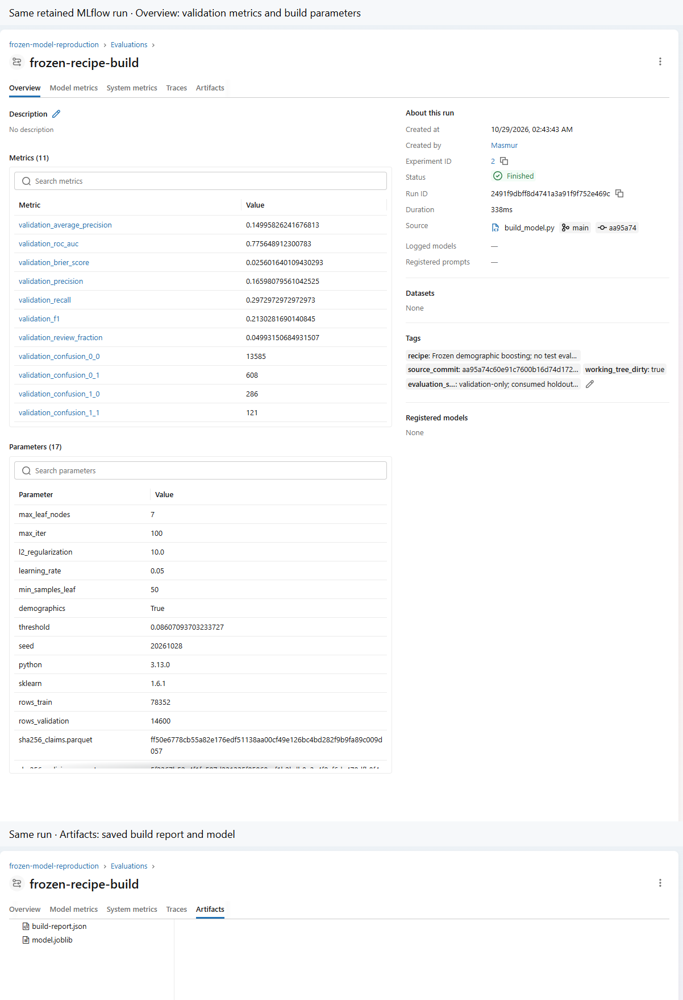
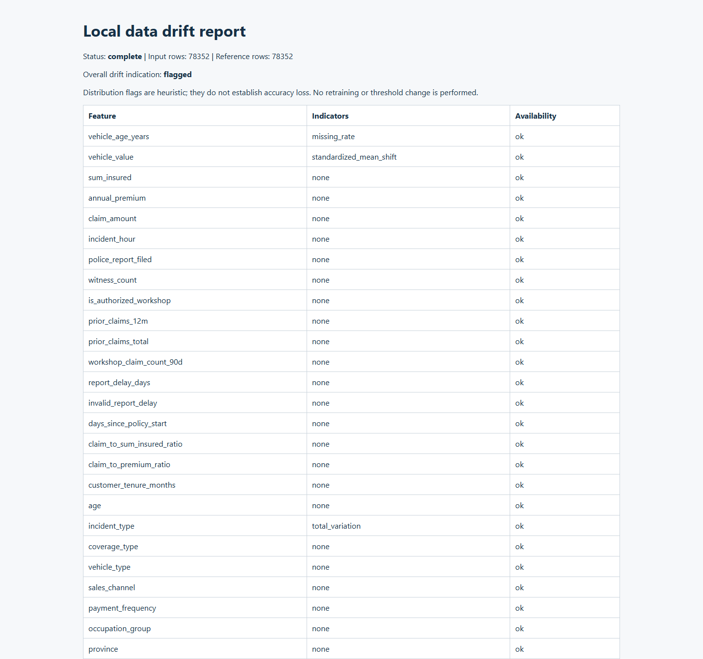

# Insurance Claim Review API

[](https://github.com/masmur71/insurance-fraud-detection-ml-pipeline/actions/workflows/ci.yml)


## Project overview

An end-to-end machine learning service that helps reviewers prioritize vehicle insurance claims for investigation. It prepares claim data, trains and evaluates a model, and serves scores through a tested REST API with local monitoring tools.

**Stack:** Python · scikit-learn · FastAPI · Docker · GitHub Actions · optional MLflow

The project combines software engineering—validated APIs, batch inference, automated tests, and container delivery—with ML engineering—time-based evaluation, reproducible model builds, experiment tracking, and input drift reports.

**All data is synthetic.** Results do not establish real-world fraud detection performance. A review flag prompts human investigation; it must never automatically reject a claim. Scores are uncalibrated, not confirmed probabilities of fraud. See the [dataset and generator](https://github.com/masmur71/synthetic-vehicle-insurance-fraud).

## Architecture

~~~mermaid
flowchart LR
    subgraph Training[Local training and evaluation]
        D[Synthetic claim data] --> P[Time-based split and preprocessing]
        P --> B[Build frozen model recipe]
        B --> M[Saved model artifact]
        B -. Optional tracking .-> T[MLflow: configuration, metrics, artifacts]
    end
    subgraph Serving[Containerized serving]
        M --> A[FastAPI]
        C[Single claim or batch of 1-100] --> A
        A --> R[Score and human review flag]
        A --> O[Health, counters, review volume]
    end
    subgraph Drift[Local drift analysis]
        E[Eligible training rows] --> F[Training reference profile]
        M --> F
        F --> H[JSON and HTML drift reports]
        M --> H
        N[New input batch] --> H
    end
~~~

Preprocessing and the estimator are saved together. Serving loads an explicitly selected model file; MLflow does not automatically promote models. Drift analysis is a separate local command and does not trigger retraining.

## Engineering highlights

| Capability | Implementation and evidence |
| --- | --- |
| Data pipeline and evaluation | Time-based splits, histories restricted to earlier available claims, and a frozen review cutoff. [Feature contract](docs/feature-contract.md) · [Model selection](docs/model-selection.md) |
| Single and batch inference | Shared inference logic; one model call per batch; ordered results consistent with individual predictions; invalid items reject the whole batch with indexed errors. [Batch API and verification](docs/batch-prediction.md) · [API code](src/claim_fraud/api.py) |
| Tests and container delivery | GitHub Actions runs tests, builds the model and Docker image, and checks the API before publishing to GHCR. [Workflow](.github/workflows/ci.yml) · [Tests](tests/) |
| Reproducible model builds | Optional MLflow records configuration, validation metrics, input hashes, source revision, and model/report artifacts. Download hash parity and persistence across restart were verified locally. [Tracking setup and verification](docs/operations.md#local-mlflow) |
| Input drift analysis | Training reference tied to the model hash; missingness, numeric, and categorical comparisons; JSON/HTML reports and explicit small-sample handling. [Drift guide](docs/data-drift.md) · [Implementation](src/claim_fraud/drift.py) |
| Service observability | Health checks, prediction counters, and review-volume summaries. Prediction logs exclude raw claim payloads. [Operations guide](docs/operations.md#observability) |

## Results

### Model evaluation on synthetic data

| Model and split | Average precision | Precision | Recall | Claims flagged for review |
| --- | ---: | ---: | ---: | ---: |
| Logistic baseline, validation | 0.1349 | 16.07% | 27.52% | 4.77% |
| Selected boosting, validation | 0.1500 | 16.60% | 29.73% | 4.99% |
| Selected boosting, frozen test | 0.1402 | 14.40% | 33.07% | 7.43% |

The selected model is scikit-learn histogram gradient boosting, trained on **78,352 eligible claims**. Validation contains 14,600 claims; the separate test contains 55,116. Selection targeted recall within a 5% validation review workload.

**Operational finding:** the same fixed cutoff increased review volume from **4.99% on validation to 7.43% on test**. A validation workload constraint does not guarantee future capacity. These are historical results; the consumed test set is excluded from subsequent tuning and build/drift demonstrations. See the [model card](docs/model-card.md) for methodology, errors, and limitations.

### Batch API benchmark

| Processing 100 claims | Median total time |
| --- | ---: |
| Sequential individual HTTP requests | 1.8592 s |
| One batch HTTP request | 0.0240 s |

Measured locally on October 29, 2026, using the same Docker container and model artifact, deterministic synthetic example claims, one warmup, and ten measured rounds per mode. The Windows client used Python 3.13; the server used Python 3.11, one worker, and one model thread. Times include serialization and loopback HTTP round trips. These describe this machine and workload, not production capacity. See [benchmark methodology](docs/batch-prediction.md#local-benchmark).

## Demo preview

### Trace a model build in MLflow



Two captured views of the same retained run: the Overview tab shows configuration and validation metrics; the Artifacts tab lists the saved model and build report. This is frozen-recipe reproduction, not a new model-selection experiment. [Reproduce the tracking workflow](docs/operations.md#local-mlflow). [Screenshot provenance](docs/assets/README.md).

### Inspect controlled changes in input data



The training-only demonstration compares 78,352 reference rows with controlled synthetic changes. It flags increased missingness in vehicle age, a numeric shift in vehicle value, and a new incident category. Flags prompt investigation; they do not prove accuracy loss. [Run the demonstration](docs/data-drift.md#try-the-demonstration).

## Quick start

### Build and run locally

You need **Python 3.11, Git, and Docker with Linux containers**. Use PowerShell and run these commands from the project folder.

```powershell
git clone https://github.com/masmur71/insurance-fraud-detection-ml-pipeline.git
cd insurance-fraud-detection-ml-pipeline
python -m venv .venv
.venv/Scripts/python.exe -m pip install -r requirements-serving.txt -e ".[dev,data]"
```

Generate the synthetic data, check it, and build the model:

```powershell
.venv/Scripts/python.exe scripts/generate_data.py
.venv/Scripts/python.exe scripts/audit_data.py
.venv/Scripts/python.exe scripts/build_model.py
```

Start the API and try the demo:

```powershell
docker compose up --build -d
.venv/Scripts/python.exe scripts/wait_api.py
.venv/Scripts/python.exe scripts/demo.py
```

Open [the interactive API page](http://localhost:8000/docs) to explore requests and responses. Stop the service with `docker compose down`.

Generated data and models stay on your machine. The generator will not overwrite existing data, and the model build needs an empty output folder. If you already have the raw data, you can skip generation. Building uses the existing model recipe and decision cutoff; it does not repeat model selection or evaluate the reserved test data.

### Use the published image

To run the image published by a successful GitHub build, without training locally:

```powershell
$env:API_IMAGE = 'ghcr.io/masmur71/insurance-fraud-detection-ml-pipeline:latest'
docker compose pull
docker compose up -d --no-build
```

Then open [the API page](http://localhost:8000/docs). If the image requires sign-in, see the [operations guide](docs/operations.md). The service runs locally; this repository does not provide a public API server.


### Make a prediction

~~~powershell
$payload = Get-Content examples/claim.json -Raw
Invoke-RestMethod -Method Post -Uri http://127.0.0.1:8000/predict -ContentType 'application/json' -Body $payload
~~~

The response includes `score`, `threshold`, `review_required`, `reason_codes`, and `model_version`. Reason codes are input checks, not explanations of the model score. See the [example response](examples/prediction.json), [input contract](docs/feature-contract.md), and [batch API](docs/batch-prediction.md) for 1–100 claims per request.

### Verify and explore

~~~powershell
.venv/Scripts/python.exe -m pytest -q
# With the API running and the same model file available locally:
.venv/Scripts/python.exe scripts/smoke_api.py
# With training data and the frozen model available; output folder must be empty:
.venv/Scripts/python.exe scripts/demo_drift.py
Start-Process reports/drift-demo/controlled-shift/drift-report.html
~~~

The smoke check covers individual and batch predictions. MLflow is optional and installed separately; see [tracking setup](docs/operations.md#local-mlflow).

## Documentation

| Read next | What you will find |
| --- | --- |
| [Model card](docs/model-card.md) | Intended use, evaluation, errors, and limitations |
| [Model selection](docs/model-selection.md) | Baseline comparison, selection criteria, and frozen cutoff |
| [Feature contract](docs/feature-contract.md) | Input validation, feature definitions, and history rules |
| [Batch API](docs/batch-prediction.md) | Request/response contract, validation, parity tests, and benchmark |
| [Operations guide](docs/operations.md) | Docker, CI delivery, monitoring, rollback, and optional MLflow |
| [Local data drift](docs/data-drift.md) | Reference profiles, report generation, and indicator interpretation |

Browse [application code](src/claim_fraud/), [runnable scripts](scripts/), and [automated tests](tests/).

This learning project has no cloud deployment, automatic retraining, or Model Registry promotion. Real deployment would require real-world validation, security, fairness assessment, and a reliable source of claim histories. Monitoring tracks scores and review volume; prediction correctness requires confirmed outcomes.
