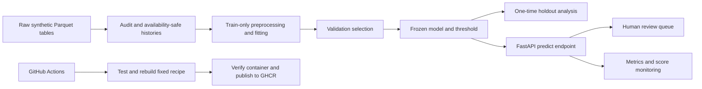

# Insurance Fraud Detection ML Pipeline

[](https://github.com/masmur71/insurance-fraud-detection-ml-pipeline/actions/workflows/ci.yml)


An end-to-end machine learning service that prioritizes vehicle insurance claims for **human review**: raw data, leakage-safe features, time-based evaluation, a versioned model, FastAPI, Docker, monitoring, and continuous delivery to GitHub Container Registry.

**This is a synthetic benchmark, not a production fraud detector.** Scores are uncalibrated and must not be used to reject claims automatically. All reported results use **synthetic data**, seed `20261028`.

## What this project demonstrates

- **Data integrity:** duplicate/conflict checks, foreign-key checks, and explicit feature allowlists exclude settlement outcomes and latent truth.
- **Time-aware modeling:** train/validation/test follow incident dates; report availability determines training eligibility. Histories use strictly earlier available claims, excluding same-day peers.
- **Operational evaluation:** models compete on recall under a 5% validation review budget. Model and thresholds are frozen before holdout evaluation.
- **Shared training and serving:** one serialized preprocessing/model pipeline handles missing values, unseen categories, clipping, and derived features.
- **Delivery:** behavioral tests, a non-root Python 3.11 container, CI-gated image publication, HTTP parity checks, and bounded runtime telemetry.



## Results

**Synthetic data, seed `20261028`.** AP means average precision, not trapezoidal PR-AUC. The baseline and selected model are compared on the same validation split; the test row is a separate evaluation of the frozen winner.

| Model / split | Average precision | Precision | Recall | Claims flagged |
|---|---:|---:|---:|---:|
| Logistic regression / validation | 0.1349 | 16.07% | 27.52% | 4.77% |
| Selected gradient boosting / validation | 0.1500 | 16.60% | 29.73% | 4.99% |
| Selected gradient boosting / frozen test | 0.1402 | 14.40% | 33.07% | 7.43% |

The selected model uses histogram gradient boosting with 7 leaves, 100 iterations, learning rate 0.05, and L2 regularization 10. Its threshold is `0.08607093703233727`.

**The most important finding is the capacity gap:** a threshold selected for at most 5% review on validation flagged 7.43% on test. It found 590 observed positives, flagged 3,506 negatives, and missed 1,194 positives. A static threshold does not guarantee a stable review queue.

Ten configurations compared weighting, boosting complexity, and demographic features. Demographic and non-demographic boosting tied on validation recall; demographics won by only **0.00031 AP**. This does not establish a meaningful demographic benefit or fairness. See the [model card](docs/model-card.md) and [error analysis](docs/phase-3-models.md).

## Quick start: build locally

Requirements: Python 3.11, Git, and Docker with Linux containers. Commands below use PowerShell. Run them from the repository root.

```powershell
git clone https://github.com/masmur71/insurance-fraud-detection-ml-pipeline.git
cd insurance-fraud-detection-ml-pipeline
python -m venv .venv
.venv/Scripts/python.exe -m pip install -r requirements-serving.txt -e ".[dev,data]"
.venv/Scripts/python.exe scripts/generate_data.py
.venv/Scripts/python.exe scripts/audit_data.py
.venv/Scripts/python.exe scripts/build_model.py
docker compose up --build -d
.venv/Scripts/python.exe scripts/wait_api.py
.venv/Scripts/python.exe scripts/demo.py
```

The generator runs the existing notebook's generation/export cells without EDA or diagnostic training. Data and model outputs stay local and are not committed. Generation refuses to overwrite existing Parquet data; model building requires an empty output directory. Use `--output-dir` for a separate reproduction.

**From existing raw tables to a serving bundle, one command is enough:** `python scripts/build_model.py`. It reproduces the already selected configuration and threshold, fits only eligible training claims, and records validation metrics and input hashes. It never scores the test split or repeats model selection.

The API is available at [localhost:8000/docs](http://localhost:8000/docs). Stop it with `docker compose down`.

## Run the published image

After a successful `main` workflow, no local training is required:

```powershell
$env:API_IMAGE = 'ghcr.io/masmur71/insurance-fraud-detection-ml-pipeline:latest'
docker compose pull
docker compose up -d --no-build
python scripts/wait_api.py
python scripts/demo.py
```

Use a full source commit SHA instead of `latest` to pin a release. Package visibility may initially require GHCR authentication; see [deployment and rollback](docs/operations.md). This project deploys locally and publishes a container image; it does not provide a hosted public API.

## API example

A complete request is in [`examples/claim.json`](examples/claim.json):

```powershell
$payload = Get-Content examples/claim.json -Raw
Invoke-RestMethod -Method Post -Uri http://127.0.0.1:8000/predict -ContentType 'application/json' -Body $payload
```

The response contains:

| Field | Meaning |
|---|---|
| `score` | Uncalibrated model score between 0 and 1 |
| `threshold` | Frozen validation-selected cutoff |
| `review_required` | Whether `score >= threshold` |
| `reason_codes` | Input rule indicators, not model explanations |
| `model_version` | SHA-256 of the exact model artifact |
| `score_kind`, `dataset`, `seed` | Explicit score and synthetic-benchmark labels |

See [`examples/prediction.json`](examples/prediction.json) for an actual response from the original frozen model. The model hash may differ after a rebuild.

All input keys are required. Measurements and categories may be `null`; histories and dates may not. Dates use `YYYY-MM-DD`; histories are nonnegative integers with `prior_claims_12m <= prior_claims_total`. Unknown nonempty categories are supported. Extra fields, invalid counts, non-finite numbers, and invalid dates receive HTTP 422. Caller-supplied histories must follow the [feature contract](docs/feature-contract.md).

Reason codes are `INVALID_REPORT_DELAY`, `CLAIM_EXCEEDS_SUM_INSURED`, and `NO_POLICE_REPORT`. They do not explain the estimator's decision and may appear whether or not review is required.

| Endpoint | Purpose |
|---|---|
| `GET /health` | Readiness and model artifact version |
| `POST /predict` | Validate and score one claim |
| `GET /metrics` | Prometheus request, duration, prediction, and review counters |
| `GET /monitoring` | Score distribution and review-volume shift summary |
| `GET /docs` | Interactive OpenAPI documentation |

## Test and reproduce

```powershell
.venv/Scripts/python.exe -m pytest -q
.venv/Scripts/python.exe scripts/smoke_api.py
```

The HTTP smoke check compares three requests against the **same local artifact** at tolerance `1e-12`. It requires a running API and checks artifact identity, missing values, unseen categories, invalid reporting delay, threshold decisions, and rejection of truth fields. To test a remote or alternate port, pass `--url`.

The original research commands remain available:

```powershell
python scripts/train_baseline.py
python scripts/train_phase3.py tune
python scripts/train_phase3.py evaluate
```

These are historical experiment entry points, not release prerequisites. Use a new output directory for reproductions. The repository's holdout has already been consumed: do not tune against its findings or present repeated evaluations as fresh evidence. [Phase 2](docs/phase-2-baseline.md), [phase 3](docs/phase-3-models.md), and [phase 4](docs/phase-4-api.md) document the original protocol and verification.

## CI/CD and monitoring

[GitHub Actions](https://github.com/masmur71/insurance-fraud-detection-ml-pipeline/actions/workflows/ci.yml) runs tests on Python 3.11, generates and audits synthetic data, rebuilds the fixed model recipe, builds the image, and checks live HTTP parity. Only a successful `main` run publishes the tested image to GHCR. Pull requests cannot publish images. Image tags include the full commit SHA and `latest`.

Prediction logs contain model hash, score, and review flag, without raw claim payloads or identifiers. Counters are thread-safe, per process, and reset on restart. The review-volume indicator activates above 7.5% after 100 predictions; it is an illustrative operating rule, not a statistical drift test. There is no external alert delivery or persistent telemetry backend. See the [operations guide](docs/operations.md).

## Repository map

```text
data/notebooks/       Synthetic generator and read-only EDA
docs/                 Feature contract, analysis, model card, operations
examples/             Complete request and observed response
scripts/              Generate, audit, train, build, demo, smoke checks
src/claim_fraud/       Shared features, estimators, API, validation, monitoring
tests/                Behavioral data, model, API, and monitoring tests
.github/workflows/    CI and GHCR delivery
Dockerfile            Python 3.11 serving image
compose.yaml          Local deployment
```

## Limitations

- Synthetic success does not establish real fraud detection. The estimator can recover patterns planted by the generator.
- Labels are noisy, and maturity timestamps are absent. Real deployments need delayed-label validation.
- Demographics introduce proxy/fairness concerns; this project does not certify fair outcomes.
- Scores are not calibrated probabilities; review flags are not claim rejection decisions.
- The API trusts caller-supplied histories and has no live history database.
- Monitoring has no ground-truth labels and cannot estimate live precision or recall.
- The local demo has no authentication, public ingress, or production monitoring stack. Only trusted joblib artifacts may be loaded.

The next steps for real deployment are suitable data access, label-maturity validation, subgroup assessment, calibration, and capacity-aware review operations—not further optimization on this consumed synthetic test set.

## Local experiment tracking

Install the optional tracking extra with `python -m pip install -e '.[tracking]'`.
See [the operations guide](docs/operations.md#local-mlflow-phase-6) for startup, frozen builds, artifact verification, and recovery. Serving does not require MLflow.
